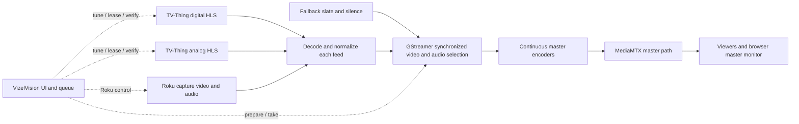

# TV-Thing sources and shared queue

Proposal · September 10, 2026 · Individual feeds → GStreamer switching → MediaMTX master stream

September 13 progress: TV-Thing prepare/take, persistent publication, LAN master
control, [shared Roku capture](roku-contribution.md),
[verified Roku master takes](roku-master.md), and the first
[mixed-source queue](source-queue.md) are implemented. The old web service is
retired. The source queue now drives verified master takes, with pause/resume,
program snapshots, missed/failed blocking, migration and manual restart review.
Analog hardware validation remains deferred by the operator.

Next: longer operational observation, advance preparation of independent inputs,
clearer overlap warnings, and automatic reconciliation of interrupted queue takes.
The earlier input stall was not reproduced in five-minute observations of each
current digital and Roku feed; source/track diagnostics now record any recurrence.

## Recommendation

Extend the existing Master Control page with a source list, a Now / Next guide grouped by source, and one persistent queue controlling a continuous master stream. List TV-Thing Digital, TV-Thing Analog, YouTube TV, and MLB.TV. Source selection filters the guide; only **Take to master** or an enabled queue transition changes the master output. The browser monitors the same MediaMTX master path that viewers consume. Keep the on-air source visible while browsing another source.

The companion `source-queue-concept.html` is an interactive layout concept with illustrative programs. It simulates source filtering, Take to master, adding queue entries, and reordering/removing them. It does not contact hardware or execute timed playback.

## API review and live evidence

Reviewed the neighboring repository's `API.md`, `static/openapi.json` (OpenAPI 3.1, contract version 1.0.0), and implementation in `server.py`. Also performed read-only GET requests against `http://127.0.0.1:8080/` on September 10. No lock, tune, scan, refresh, stop, or service mutation was performed.

Observed snapshot:

- Versioned discovery and source/status/guide endpoints responded successfully.
- Digital catalog reports 70 channels; analog catalog reports 135 cable channel selections and an available tuner. Catalog size is not a count of receivable stations.
- Digital was serving WUSA-HD 9.1 with a ready, healthy HLS generation; analog was idle.
- Now/next contained entries for 52 channels. The full guide reported approximately 10.3 hours of remaining coverage. Coverage varies by station; this is not a guaranteed guide horizon for every channel.
- Neither lane had a current lease. This observation is not a reservation.

| Need | TV-Thing API | Integration use |
| --- | --- | --- |
| Discovery | `GET api/v1`, `GET api/v1/sources` | Validate version and discover available source/lane information |
| Channel choices | `GET api/v1/sources/digital`, `GET api/v1/sources/cable` | Preserve opaque digital IDs; analog uses a numeric channel |
| Current and upcoming shows | `GET api/v1/guide/now`, `GET api/v1/guide?hours=12` | Read cached PSIP guide; derive current/next from full guide if needed |
| Ownership | `POST api/v1/tuner/lock` | Acquire and renew the appropriate lane lease |
| Tune | `POST api/v1/tune` | Digital: `source=digital`, `channel_id`; analog: `source=cable`, `channel`; both include quality and token |
| Readiness and selection | `GET api/v1/status` | Check the requested lane, selection, generation, health, and ownership |
| Playback | Returned `stream.playback[]` descriptor | Resolve HLS URL against the configured application base |
| Cleanup | `POST api/v1/tuner/lock/release` | Release our lease when leaving the lane; shared playback remains running |

Use an application base ending in `/`, such as `http://viviserv/tv/` or the direct local address. Prefix-aware URL resolution matters: a descriptor such as `stream/digital.m3u8` belongs under `/tv/`, not `/tv/api/v1/`. Discovery also returns root-style API paths; the adapter must preserve the configured application prefix when constructing those requests.

### Constraints that affect the product

1. **Live programs cannot be held for later.** A TV-Thing playlist follows its shared tuner lane through channel changes. The contract provides no recording or DVR timeline. A queue entry means “tune at this time/condition”; a late entry can join in progress, but an ended program cannot be replayed through this API.
2. **Two independent TV-Thing lanes, one channel per lane.** Digital and analog can run together. Retuning a digital channel changes what every consumer of that digital lane receives. YouTube TV and MLB.TV also share the existing single Roku, so they are two content sources backed by one control resource.
3. **Guide coverage is uneven.** Digital guide data includes event ID, title, Unix start time and duration. Associate channels using catalog IDs and the guide's channel metadata/number, then use `start + duration` for scheduled end. Analog has no matching program guide in the reviewed contract. VizelVision's YouTube TV integration currently has a channel catalog but no full EPG; MLB has its existing game schedule. Show “Listings unavailable” where appropriate. Do not infer that an OTA affiliate's schedule is identical to a YouTube TV feed without an explicit mapping.
4. **Guide reads are safe; refreshing is a tuner operation.** UI refresh should reread cached listings. Do not invoke TV-Thing's guide-refresh or scan endpoints as part of browsing. Long ownership leases may defer TV-Thing's own guide refresh, so expose guide age and coverage.
5. **Lease tokens are private.** TV-Thing trusts LAN callers and has no authentication. Make control calls from the VizelVision backend, retain tokens privately, and expose only public owner/expiry summaries. Never automatically set `override` after a refusal.
6. **The current Roku image preview is not a complete contribution feed.** TV-Thing already supplies HLS video/audio. The Roku capture code currently drains decoded images for verification; the master pipeline needs continuous video AND audio from the capture device, with one hardware owner and a separate fresh-frame verification branch. Do not feed the master from the HTTP image preview or open a competing capture process.

## Master stream architecture

GStreamer owns media switching; VizelVision owns program selection, queue conditions, and TV-Thing leases; MediaMTX distributes the selected encoded output. Viewers stay connected to one stable master path across ordinary takes.

Use a long-running GStreamer worker controlled by VizelVision over a local IPC interface. Build/manage the graph with bindings rather than spawning a new `gst-launch` process per switch. This introduces system GStreamer/plugins/bindings requirements, which should be inventoried and documented separately from the current dependency-free Python control service.

Each contribution branch decodes, deinterlaces if necessary, scales/rate-converts to one fixed video format, and converts/resamples to one audio format. Start evaluation at 1280×720, 30000/1001 fps and stereo 48 kHz; select the final profile from measured quality and host capacity, including the existing 60 fps Roku capture. Normalize timestamps/segments to the pipeline running clock and bound input queues. Supply silence for inputs without audio.

Use paired video/audio `input-selector` elements and coordinate both changes at a defined running-time boundary with pad blocking/control-thread synchronization. Two independent property assignments do not by themselves guarantee an atomic A/V cut. Start evaluation with `sync-streams=true`, `sync-mode=clock`, `cache-buffers=true`, and `drop-backwards=true` where supported (GStreamer 1.22+ for the last property). Those options assist synchronization; source timestamp discontinuities, HLS reconnection, and A/V alignment still require explicit handling and tests. [GStreamer input-selector documentation](https://gstreamer.freedesktop.org/documentation/coreelements/input-selector.html).

Place persistent master encoders AFTER selection to keep codec configuration and timestamps stable as inputs change. Evaluate H.264 video + AAC audio, publishing separate elementary tracks with `rtspclientsink` to a configured MediaMTX path such as `rtsp://127.0.0.1:8554/master` (illustrative address, not verified deployment configuration). GStreamer publishing over RTSP is documented by MediaMTX. [MediaMTX GStreamer publishing](https://github.com/bluenviron/mediamtx/blob/main/docs/3-publish/18-gstreamer.md).

Initially consume that master through HLS for browser monitoring and RTSP/HLS for compatible receivers. MediaMTX handles protocol routing; do not assume it transcodes AAC into WebRTC-compatible audio. If low-latency WebRTC monitoring is required, verify the target browsers and provide a compatible audio rendition. [MediaMTX introduction](https://mediamtx.org/docs/kickoff/introduction).

This design intentionally pays the cost of decoding contributions and encoding the master to simplify switching between unlike feeds. Keep only active inputs and the next independent candidate warm initially; enforce bounded CPU, memory, queue latency and temperature budgets. TV-Thing HLS contributes existing buffering latency, so switching timing is measured at the master output and does not imply exact broadcast-wall-clock alignment. A lower-latency TV-Thing contribution protocol is a later API extension, not an assumed available endpoint.

A continuously running fallback slate with silence supplies media when an input disappears or the same hardware must be retuned. Branch errors/EOS must be contained so one failed source cannot shut down the master graph. Monitor publication health, reconnect to MediaMTX with bounded backoff, and supervise the worker. A stable path is achievable; seamless survival of a worker/server crash is not guaranteed and clients need reconnect behavior.

## UI and interactions

Keep the current dark Master Control styling. Desktop has three columns:

- **Left: Sources.** All sources, TV-Thing Digital, TV-Thing Analog, YouTube TV, MLB.TV. Each shows availability and the currently selected channel/game where known. Label the source actually playing separately from the source being browsed. Move Hauppauge/Dazzle capture selection into Roku input settings; those are capture devices, not program providers.
- **Center: Master monitor and guide.** Persistent monitor reading MediaMTX master, with on-air source, channel, program, audio activity, and master health. Show a smaller Ready / Preparing next-source panel beside or below it. Under it, an All sources view groups rows by provider. Each row shows channel, current program/progress, upcoming title/time, **Take to master**, and **+ Queue**. Expand a row for later listings within known coverage. Source buttons filter this area without tuning.
- **Right: Up next.** Always visible on desktop. Each entry shows source/channel, program if known, release condition, and waiting/blocked/late state, with move up/down and remove. Include Pause queue / Resume queue, and make a paused queue obvious.

On mobile, use a horizontally scrollable source selector, stacked monitor/guide, and a persistent Queue button opening a full-height sheet. Keep reorder buttons for touch and keyboard accessibility. Announce switch and queue results through a status region.

Adding a program opens a small composer:

- Upcoming program: default **At program start**; display the actual date, local time, and timezone.
- Current program/channel: require **At time**, **After current program (scheduled end)**, or **After game** when a verified MLB game is available. No silent default that immediately changes playback.
- Unknown program duration: scheduled-end condition is unavailable; a manual time is still valid.
- **After game** uses the existing exact game identity and terminal-status behavior. **After program** is a guide estimate and may cut off overrunning content; label it “Scheduled end,” never imply detection of the actual ending.

Take to master prepares and verifies the requested feed, then commits a master switch and pauses automatic queue release while preserving entries. This prevents a due queue item from immediately undoing the manual choice. Resuming shows any late or missed entries first. Queue entries can specify a source explicitly; retain the existing automatic baseball route only for entries that opt into Auto, and display the resolved route.

### Queue rules

- Preserve strict order: only the head is eligible. “At 8:00 PM” means eligible at 8:00 PM when it reaches the head, not permission to jump ahead.
- Show overlapping program times or a time entry blocked by an earlier condition before adding/resuming; offer reorder or removal. Do not silently discard entries.
- If a program is still airing when its turn arrives, join live and label it late. If it has ended, block it as **Missed** and require Skip or an explicit **Tune channel anyway**. Do not silently show a different program under the queued title.
- Track actual playing selection separately from cue completion. The current queue marks an operation successful after tuning; that is not evidence the program finished. A new scheduled-end gate must bind to a specific program snapshot, not the previous cue's completion timestamp.
- Capture event identity using source/channel/event ID/start time; broadcast event IDs alone can repeat. Save title/start/end snapshots and revalidate before release. Material schedule changes pause the affected entry for review.
- A busy/locked tuner keeps the head waiting with bounded retries. Expired programs become Missed. A terminal tune failure blocks progression until Retry or Skip, preventing cascading unexpected switches.
- Persist queue pause state and migrate existing entries to YouTube TV without losing order or release conditions. Reconcile an interrupted switch against device status after restart before executing it again.

## Implementation sequence

### 1. Source model and read-only guide

Add a provider interface in `roku_stream/sources.py`, a TV-Thing HTTP adapter in `roku_stream/tv_thing.py`, and configuration in `config.py`/`config.example.json`. Keep the existing controller as the Roku adapter.

Represent provider/source separately from hardware resource: `tv_thing:digital`, `tv_thing:analog`, and `roku:primary`. Normalize channel/program metadata, readiness, optional guide coverage, and capabilities. New backend routes can be `GET /v1/sources` and `GET /v1/sources/{id}/programs`; leave existing Roku routes compatible.

Cache guide/catalog data, coalesce requests, use bounded HTTP timeouts, and retain stale data with a visible timestamp during an outage. Suggested starting intervals: catalog 5 minutes, guide 60 seconds, active-source status 2 seconds, with backoff while unavailable. These are client defaults, not documented server rate limits. Filter current programs by clock locally: the full-guide implementation can include recently ended events.

Deliverable: all-source guide displays real digital current/upcoming programs and honest missing-listing states without changing hardware.

### 2. Persistent master pipeline and safe takes

First build the GStreamer/MediaMTX worker with two bounded synthetic A/V feeds plus fallback, independent of production hardware. Verify a continuous master publish session through repeated cuts before adding TV-Thing and Roku contribution branches. Add worker status and prepare/take/cancel commands with operation IDs; only the worker's confirmed cut updates the server's on-air target.

Add a source coordinator (`roku_stream/source_coordinator.py`) used by manual actions, queue execution, and existing timed scheduler operations. It serializes operations and tracks active output independently of the source browser. Reuse existing progress/history with source fields.

TV-Thing preparation: acquire lane lease → tune with token → poll that lane for expected selection/generation/readiness → connect the returned HLS descriptor to a contribution branch → verify fresh decoded A/V and healthy timestamps → mark ready. At the take boundary, select synchronized video/audio, verify outgoing media, then publish the committed on-air identity. Browser player health is reported separately from worker output health.

Renew according to the actual granted lease expiry, e.g. halfway through. A changed generation requires renewed selection/ownership verification. Lost lease-acquisition responses cannot be recovered by treating the owner label as a credential. Release unused prepared leases on cancel/timeout, while preserving ownership of the currently active resource. Release the old lane after a confirmed cross-resource take; never stop shared TV-Thing playback as cleanup.

Roku preparation requires one owner of the HD PVR capture. Add a media branch for continuous video/audio and a bounded, independently queued verification branch preserving device-identity checks, request barriers, fresh-frame discard and cancellation. Prevent a slow observer from stalling outgoing media. Determine the exact demux/decode/capture sharing change after inspecting installed plugins and hardware capabilities; the current PPM-only reader cannot supply audio.

When resources are independent, keep the current program on master while warming the next. For same-lane channel changes, and YouTube TV ↔ MLB on the single Roku, take fallback before retuning or navigating so tuner gaps and Roku menus do not go on air. Then take the verified new feed. Queue UI should mark these transitions “Brief slate during retune.” Seamless same-resource preparation needs an additional tuner/Roku.

Keep the master video player attached to one URL across takes; its LIVE indicator depends on actual playback, while the worker tracks outgoing buffers and MediaMTX publication independently. Serve the HLS player/library and allowed media through the Apache layout with suitable CSP, MIME types and segment caching. Add a preview path for a prepared independent input only if useful; preview must not be mistaken for master output.

During an external tuner override, invalidate input identity promptly and take fallback if the on-air feed is no longer the owned selection. One HLS lane URL can change content, so API readiness alone is insufficient. On shutdown/restart, reconcile leases and actual worker output before resuming automation. Continue playout and ownership renewal even with all browser tabs closed.

Deliverable: one MediaMTX master path, confirmed takes among TV-Thing and the Roku, continued publication during ordinary switches, and truthful fallback/error states.

### 3. Mixed-source persistent queue

Extend `QueueItem` in `playout_queue.py` with a source-qualified target, program snapshot, and scheduled-end gate. Change its executor from a channel string to a normalized target. Extend `/v1/queue`, preserve legacy requests, migrate persisted state, and add pause/resume/retry/skip handling. Preserve existing at-time and game gates. Route legacy timed jobs through the same coordinator to prevent conflicting switches.

Prepare the head in advance only when its resource is independent of the on-air source, using measured warmup latency. Do not acquire long leases for every future queue entry. For same-resource transitions, stay on the current program until the release condition, then use the fallback/retune sequence. A release gate triggers a take; it does not mean the next feed has already been decoded.

Deliverable: digital, analog, YouTube TV, and MLB targets in one ordered queue driving master takes, with clear missed/blocked states and restart recovery.

### 4. UI and verification

Evolve `static/cue-sheet.html` using the companion concept. Add source filtering, grouped program rows, program-aware composer, persistent queue panel/mobile sheet, and source settings. Keep source availability separate from overall service/Roku health so TV-Thing works when Roku is unavailable.

Required focused tests: guide joins/timezone/DST/missing metadata; application-prefix URL handling; lease acquisition/renewal/expiry/lost response; 423/409 handling; generation changes; readiness timeout/cancel cleanup; queue migration, order, late/missed programs, schedule changes and restart reconciliation; collisions among manual, queue and scheduled operations. Browser checks should prove browsing does not tune, master takes wait for verified media, queue persists across filters, keyboard controls work, and mobile fits.

Validate the media plane separately: continuous subscriber sessions across cuts; monotonic PTS/DTS; constant output format; A/V sync; repeated same/cross-resource transitions; fallback on lost audio/video, HLS discontinuities and lock override; worker/MediaMTX restart recovery; and bounded resource use under the maximum planned warm inputs. Define numeric pass limits before hardware trials and record measured switch latency; do not promise gapless timing based on selector configuration alone.

Run the existing Python suite and appropriate browser regression checks. Validate actual cross-source transitions in an isolated candidate before deployment. If implementation changes TV-Thing tuning/FFmpeg/HLS/player behavior or that service, its `AGENTS.md` requires the real-stream resource gate on viviserv (three real retunes and resource/integrity limits) before and after promotion. This proposal itself changes only documentation and a standalone mockup.

## First release boundary

Ship source discovery, digital guide, the GStreamer switcher, one continuous MediaMTX master stream, a master browser monitor, and a shared queue. Analog and YouTube TV remain usable without invented listings; MLB retains its game schedule. Full YouTube TV EPG, recording/time shifting, dissolves/mixing, additional independent hardware, and alternate low-latency contribution/output codecs are follow-on work.
